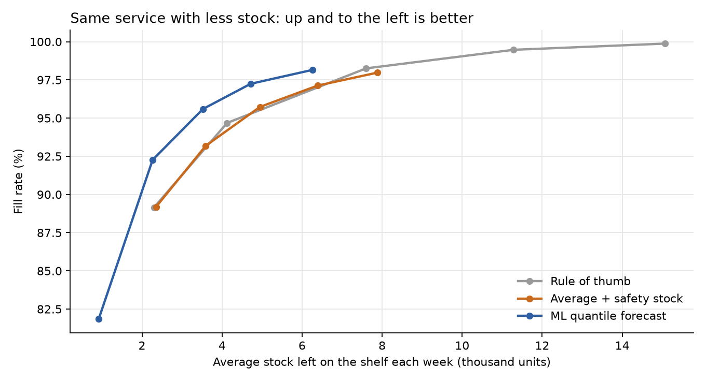
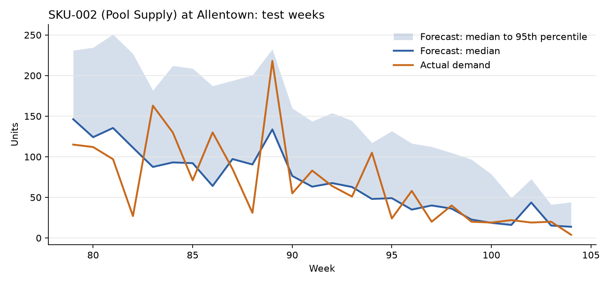

# Demand Forecasting and Inventory Optimization

Forecasting weekly demand for 160 product and branch combinations, then turning the forecasts into stocking decisions. The machine learning forecast reaches a 95% fill rate with about 25% less stock on the shelf than the usual rules of thumb.

## Why I built this

A forecast is really only useful if it changes or informs a decision. Most forecasting projects tend to stop at an accuracy number but I wanted to carry it one step further and ask the question a distributor or retailer would cares about: how much should each branch stock, and what does a better forecast save?

The data used is synthetic and it is two years of weekly sales for a made-up building supply distributor with 40 products in 4 branches.

## Results

**Forecast accuracy** on the last 26 weeks, which the models never saw:

| Forecast | Error (WAPE) | Bias |
|---|---:|---:|
| Average of the last 4 weeks | 35.2% | +0.1% |
| ML, stockouts ignored | 30.5% | -1.8% |
| ML, stockouts repaired | 30.5% | -0.7% |

**Inventory**, simulated week by week over the same 26 weeks:



| Fill rate target | Rule of thumb | Average + safety stock | ML quantile forecast | ML saving |
|---|---:|---:|---:|---:|
| 90% | 2,580 units | 2,603 units | 2,003 units | 22% |
| 95% | 4,436 units | 4,558 units | 3,312 units | 25% |

Units are the average stock left on the shelf at the end of each week, across all branches. At an average cost of about $23 a unit, the 95% row is roughly $101,000 of stock against $75,000.

## What I learned

**A 5-point accuracy gain turned into a 25% inventory gain.** The error only dropped from 35% to 30% but the bigger win came from the model knowing which products are unpredictable. It holds extra stock for those and less for the steady ones. 

**The textbook safety stock formula did no better than the rule of thumb.** I expected "average plus z times standard deviation" to beat "1.5 times the average" but on this data they trace almost the same curve. Both are built on the same 4-week average, so both are late to every seasonal turn and every promotion.

**Fixing stockouts mattered less than I expected.** When a branch runs out, recorded sales are lower than what customers wanted. If you train on that, the model learns to forecast low, repairing those weeks cut the bias from -1.8% to -0.7% but did not move the overall error, because only 3% of weeks were stockouts. 

**The seasonal products gained the most.** Pool supply error dropped from 41% to 35% and paint from 37% to 30%. Fasteners, which barely change through the year, went from 30% to 28%.

**The forecast ranges are honest.** A 90th percentile forecast should be above actual demand 90% of the time. Checked on the test weeks:

| Target | 50% | 80% | 90% | 95% | 98% |
|---|---:|---:|---:|---:|---:|
| Actual | 51.6% | 79.1% | 88.4% | 93.6% | 96.7% |

They run a little low at the top end, so a planner aiming for 95% should use the 98th percentile forecast.



## How it works

1. **Features** (`src/features.py`). Sales from 1, 2, 3, 4 and 52 weeks ago, 4-week and 13-week averages, recent variability, promotion flags, and the time of year and every feature uses only weeks before the one being forecast.
2. **Stockout repair**. A stockout week's sales are replaced with the average of the last four normal weeks, if that is higher.
3. **Models** (`run_analysis.py`). Gradient boosted trees from scikit-learn where one model predicts expected demand and five more predict the 50th, 80th, 90th, 95th and 98th percentiles using quantile loss.
4. **Time split**. Weeks 1 to 78 train, weeks 79 to 104 test with no shuffling, as shuffling time series leaks the future into training.
5. **Inventory simulation** (`src/inventory.py`). Each week stock is topped up to a target, customers buy up to what is there, unmet demand is lost, and leftovers carry over. 
6. **Scoring against demand**. The generator saves what customers actually wanted, including during stockouts. Models train on recorded sales only and are scored against true demand.

## Limits

- The data is synthetic, and the demand pattern is simpler than real data would be as there are no new products, no price changes, and no competitors.
- Replenishment arrives within the week and longer lead times would widen the gap between policies but would need forecasts further ahead.
- Leftover stock is counted in units where a proper analysis would probably weigh holding cost against margin for each product.
- One train and test split was run but repeating it over several cut-off dates would show how stable the numbers are.

## Run it

```
python -m venv venv
source venv/bin/activate
pip install -r requirements.txt

python generate_sales.py     # optional, the data is already in the repo
python run_analysis.py
pytest
```

## Files

```
generate_sales.py     builds the sales history and the true demand (seeded)
run_analysis.py       forecasts, accuracy, inventory simulation, charts
src/features.py       stockout repair and feature building
src/inventory.py      weekly inventory simulation
data/                 weekly sales
answer_key/           true demand, used only for scoring
outputs/              tables and charts
tests/                unit tests
```

## Tools

Python (pandas, NumPy, scikit-learn), matplotlib, pytest
